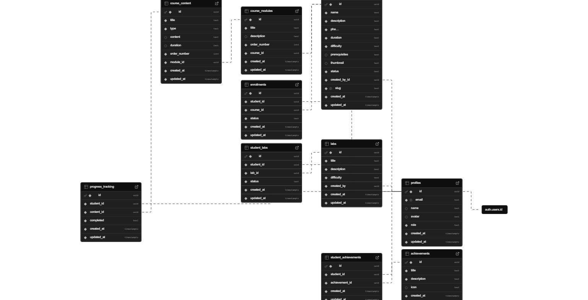

<div align="center">


# CyberMentor Academy

**A learning management system (LMS) built for a six-month cybersecurity training program.**

Admins create courses, enroll students and track payments. Students follow a structured learning path, keep notes, and track their progress.


</div>

---

## Table of Contents

- [Overview](#overview)
- [Key Features](#key-features)
- [Tech Stack](#tech-stack)
- [Architecture](#architecture)
- [Data Model](#data-model)
- [Getting Started](#getting-started)
- [Project Structure](#project-structure)
- [Application Routes](#application-routes)
- [Documentation](#documentation)
- [Roadmap](#roadmap)
- [Author](#author)

---

## Overview

**CyberMentor Academy** is a full-stack web platform for the CyberMentor cybersecurity pathway, a six-month program split into monthly phases. It replaces spreadsheets and scattered course materials with one place where:

- **Admins** create and organize course content, enroll students, manage their access and payment status, and see platform-wide statistics.
- **Students** log in to a dashboard, work through the courses unlocked for their phase, take notes, track their progress and earn achievements.

The platform is **invite-only**: there is no public sign-up. Admins enroll students, and a student's access depends on their account status (`active`, `invited`, `suspended`, `payment_due`, ...) and their payment plan (monthly or full program).

I designed it from a product spec I wrote myself (see [`docs/`](docs/)), which covers the PRD, the software requirements specification and the UI design document.

---

## Key Features

### 🛡️ Authentication & Access Control
- Email/password login with **Supabase Auth**, plus a password reset flow.
- **Role-based routing** (`admin` / `student`) enforced by a `ProtectedRoute` wrapper.
- **Status-based access checks.** Students who are `suspended` or `payment_due` are signed out automatically and told why.
- Invite-only enrollment: admins create accounts with the Supabase Admin API (invitations or direct creation).

### 🧑‍💼 Admin Panel
- **Dashboard** with stats on students, courses and activity.
- **Student management**
  - Searchable, filterable student table (by status and date range).
  - Bulk actions and a per-student action menu (activate, suspend, edit, delete).
  - Contact details, including an auto-generated **WhatsApp link** from the phone number.
  - **Payment tracking** for monthly vs. full-program plans, using program start date and months paid to flag `payment_due` students.
- **Course management**
  - Create, edit and publish courses with level, phase, difficulty, duration and prerequisites.
  - **Drag-and-drop reordering** of courses and content (`@dnd-kit`).
  - **Thumbnail and video uploads** to Supabase Storage buckets.
  - A **Markdown editor** for lesson content.
  - Hierarchy of course → modules → content items.

### 🎓 Student Experience
- **Personal dashboard** with progress summary cards, charts (Recharts) and a "continue learning" section.
- **Courses grouped by phase**, with detail pages showing lessons and progress.
- **My Notes**: personal notes saved to the database.
- **Labs**, **Achievements** and **Leaderboard** pages for hands-on practice and motivation.
- **Profile and settings** management.

### 🎨 UI / UX
- Modern, responsive UI built with **shadcn/ui** (Radix primitives) and **Tailwind CSS**.
- **Dark and light themes**, with the choice saved and no flash of the wrong theme on load.
- Collapsible sidebar, breadcrumbs and toast notifications.
- Animations with **Framer Motion**.

---

## Tech Stack

| Layer | Technologies |
|---|---|
| **Frontend** | React 18, TypeScript, Vite (SWC), React Router v6 |
| **UI** | Tailwind CSS, shadcn/ui, Radix UI, Lucide icons, Framer Motion, Recharts |
| **Forms & Validation** | React Hook Form, Zod |
| **Data Fetching** | TanStack Query, tRPC (type-safe API layer) |
| **Backend / BaaS** | Supabase: PostgreSQL, Auth, Storage, Row Level Security, SQL functions & triggers |
| **Content** | `@uiw/react-md-editor`, `marked` (Markdown) |
| **Interactions** | `@dnd-kit` (drag-and-drop sorting) |
| **Tooling** | ESLint, TypeScript ESLint, PostCSS, Autoprefixer |

---

## Architecture

```
┌──────────────────────────────────────────────────────────────┐
│                       React SPA (Vite)                       │
│                                                              │
│  Pages (Admin / Student) ─► Components (shadcn/ui, Tailwind) │
│          │                                                   │
│          ├── AuthContext ── session, role & status checks    │
│          ├── TanStack Query + tRPC client (type-safe calls)  │
│          └── Supabase JS client                              │
└──────────┬──────────────────────────────┬────────────────────┘
           │                              │
           ▼                              ▼
┌─────────────────────┐        ┌──────────────────────────────┐
│   tRPC routers      │        │           Supabase           │
│   (courses,         │ ─────► │  • Auth (users, invitations) │
│    students)        │        │  • PostgreSQL + RLS policies │
└─────────────────────┘        │  • Storage (videos, thumbs)  │
                               │  • SQL functions / triggers  │
                               └──────────────────────────────┘
```

**Design decisions**
- **Supabase as the backend** keeps the app serverless. Auth, database and file storage come from one provider, and access is controlled with Postgres Row Level Security.
- **tRPC** gives end-to-end type safety between the API routers and the React client, with no hand-written API types.
- **Database logic in SQL.** Profile auto-creation on signup, payment-status calculation and student-profile syncing are written as Postgres functions and triggers (see [`Schema/`](Schema/)).

---

## Data Model

<div align="center">
  
</div>

Core entities:

| Table | Purpose |
|---|---|
| `profiles` | One row per auth user: role, status, contact details, payment plan, program start date |
| `students` | Student records the admin panel uses (name, phone, WhatsApp URL, status) |
| `courses` | Course metadata: phase/level, difficulty, duration, prerequisites, thumbnail, slug, order |
| `course_modules` / `contents` | Ordered modules and lesson content inside each course |
| `enrollments` | Links students to courses |
| `progress_tracking` / `user_course_progress` | Per-student completion tracking |
| `payment_plans` / `payments` | Monthly vs. one-time plans and payment history |
| `user_notes` | Student notes |
| `labs` / `student_labs` | Hands-on labs and student lab status |
| `achievements` / `student_achievements` | Gamification |
| `level_descriptions`, `course_ratings`, `videos` | Supporting content metadata |

The schema changed over many iterations. The numbered SQL migrations in [`Schema/`](Schema/) record how it evolved: modules and content, thumbnails, notes, automated monthly payment tracking, and permission fixes.

---

## Getting Started

### Prerequisites
- **Node.js** 18+ and npm (or Bun)
- A **Supabase** project ([supabase.com](https://supabase.com))

### 1. Clone and install

```bash
git clone https://github.com/S0lGoodman/cybermentor-academy.git
cd cybermentor-academy
npm install
```

### 2. Configure environment variables

Create a `.env.local` file in the project root:

```env
VITE_SUPABASE_URL=https://<your-project>.supabase.co
VITE_SUPABASE_ANON_KEY=<your-anon-key>

# Required for admin features (creating/inviting users).
# Keep this secret and never commit it.
VITE_SUPABASE_SERVICE_ROLE_KEY=<your-service-role-key>
```

### 3. Set up the database

In the Supabase SQL editor, run the numbered migrations in [`Schema/`](Schema/) in order (`002_…` → `020_…`). Then create two Storage buckets, `course-videos` and `course-thumbnails`.

To give yourself admin access, set `role = 'admin'` on your row in the `profiles` table.

### 4. Run the app

```bash
npm run dev       # start dev server on http://localhost:8080
npm run build     # production build
npm run preview   # preview the production build
npm run lint      # lint the codebase
```

---

## Project Structure

```
cybermentor-academy/
├── docs/                    # Product docs: PRD, SRS, UI design
├── Schema/                  # SQL migrations, functions, schema diagram
├── public/                  # Static assets
└── src/
    ├── components/
    │   ├── ui/              # shadcn/ui primitives
    │   ├── students/        # Student management (filters, bulk actions, payments)
    │   └── ...              # Navbar, Sidebar, charts, modals, notes, etc.
    ├── contexts/            # AuthContext (session, role, suspension checks)
    ├── hooks/               # Reusable hooks
    ├── lib/                 # Supabase clients, student service, utilities
    ├── pages/               # Route-level pages (admin & student)
    ├── server/api/          # tRPC routers (courses, students)
    ├── types/               # Shared TypeScript types (Supabase, Student)
    ├── utils/               # tRPC client setup
    └── App.tsx              # Providers + routing
```

---

## Application Routes

| Route | Access | Description |
|---|---|---|
| `/login`, `/reset-password` | Public | Authentication |
| `/admin/dashboard` | Admin | Platform overview and stats |
| `/admin/students` | Admin | Student management and payments |
| `/admin/courses` | Admin | Course list, creation, ordering |
| `/admin/courses/:courseId/edit` | Admin | Course content editor |
| `/admin/settings` | Admin | Admin settings |
| `/student/dashboard` | Student | Personal progress dashboard |
| `/student/courses/:phaseId?/:courseSlug?` | Student | Courses by phase, course detail |
| `/student/labs` | Student | Hands-on labs |
| `/student/achievements` | Student | Earned badges |
| `/student/leaderboard` | Student | Rankings |
| `/student/profile`, `/student/settings` | Student | Account management |

---

## Documentation

I wrote the planning documents before building the platform:

- 📄 [**Product Requirements Document**](docs/PRD.md): vision, users, user stories, functional requirements
- 📐 [**Software Requirements Specification**](docs/SRS.md): system design, data model, technical requirements
- 🎨 [**UI Design Document**](docs/UI.md): layout, components and visual design

---

## Roadmap

- [x] Supabase auth with role- and status-based access
- [x] Admin student management (CRUD, filters, bulk actions, status)
- [x] Course management with drag-and-drop ordering and media uploads
- [x] Monthly / full-program payment tracking
- [x] Dark / light theme
- [ ] Finish the email invitation onboarding flow
- [ ] Quizzes and exercises that unlock the next content
- [ ] Move privileged (service-role) operations to Supabase Edge Functions
- [ ] Connect the remaining dashboard widgets (labs, leaderboard) to live data
- [ ] Automated tests (unit + end-to-end)

---

## Author

**Saul** · [GitHub @S0lGoodman](https://github.com/S0lGoodman)

If you have questions about this project or want to talk about opportunities, feel free to reach out.
